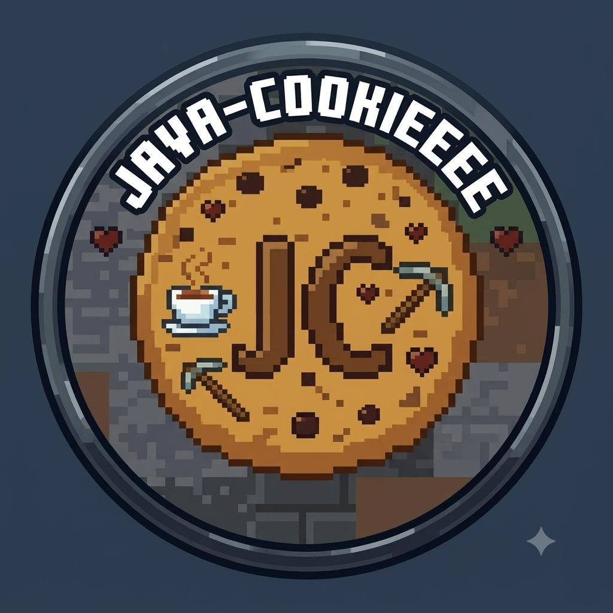

<div align="center">



# CookieKeepInv-V2

**High-performance economy-based KeepInventory plugin for Spigot, Paper, Purpur, and Folia.**

[](https://papermc.io)
[](https://adoptium.net)
[](https://papermc.io)
[](https://github.com/KhoaSuperT1/CookieKeepInv-V2)
[](LICENSE)

[Original Project (Kesuaheli)](https://hangar.papermc.io/Kesuaheli/KeepInventoryCost) · [Support Discord](https://discord.gg/NZycRMWrSS) · [MIT License](LICENSE)

</div>

---

When a player dies, **CookieKeepInv-V2** automatically evaluates world rules, PvP settings, bypass/discount permissions, cooldowns, and empty-inventory protection before charging a configurable percentage of their balance or a flat Vault fee to preserve their items and experience.

---

## Support & Links

- **GitHub Repository:** https://github.com/KhoaSuperT1/CookieKeepInv-V2
- **Discord Support Server:** https://discord.gg/NZycRMWrSS
- **Original Project (V1 by Kesuaheli):** https://hangar.papermc.io/Kesuaheli/KeepInventoryCost

---

## AI-Assisted Development Notice

> **Transparency Notice:** Approximately **70% of the recode implementation and refactoring was assisted by AI** under direct human architecture design, code review, edge-case auditing, and automated unit testing by **Java-Cookieee**.

---

## Key Features (V2 Recode)

- **Broad Version Support (`1.21` – `26.3` / `1.26.3`):** Compiled against Java 21 and the 1.21 baseline API with safe sound/inventory/message handling so the same `CookieKeepInv-V2.jar` runs on both Java 21 (1.21.x) and Java 25+ (26.1–26.3) servers.
- **Spigot, Paper, Purpur & Folia Compatible:**
  - Automatically uses native **Kyori Adventure MiniMessage** on Paper/Purpur/Folia.
  - Seamlessly falls back to legacy/hex `§x` translation on pure **Spigot** without external shaded dependencies.
  - Marked `folia-supported: true` with lock-free concurrent caches and debounced async disk writes.
- **Flexible Economy Pricing (`BigDecimal` precision):**
  - **Percent Mode:** Charge a percentage of the player's current Vault balance with configurable `min-percent-cost` floor and `max-percent-cost` cap.
  - **Flat Money Mode:** Charge a fixed amount with configurable `min-money-cost` floor.
- **Permission-Based VIP Discount Tiers:** Grant percentage discounts (e.g., `cookiekeepinv.discount.vip` for 25% off, `cookiekeepinv.discount.mvp` for 50% off) with automatic highest-tier selection.
- **Anti-Exploit & Gameplay Controls:**
  - **Empty Inventory Protection:** Skip charging when a player dies with an empty inventory and zero XP (`charge-on-empty-inventory: false`).
  - **Curse of Vanishing Support:** Strip `VANISHING_CURSE` items instead of letting KeepInventory bypass vanilla curse behavior (`respect-vanishing-curse: true`).
  - **PvP Toggle:** Optionally drop items on PvP kills while keeping PvE protection (`keep-on-pvp`).
  - **Death Cooldown:** Optional per-player cooldown (`cooldown-seconds`) between paid KeepInventory saves.
  - **Disabled Worlds:** Case-insensitive per-world exclusion list.
  - **Granular Preservation:** Independently toggle `keep-inventory` and `keep-xp`.
  - **Positive Balance Guard & Safe Fail-Safe:** Prevent zero/negative-balance bypasses and safely pause if the Vault economy provider disappears.
- **Player Cost Preview & Quick Toggles:** Players can run `/keepinv cost`, `/keepinv on`, `/keepinv off`, `/keepinv toggle`, or `/keepinv status` anytime.

---

## Requirements

1. A Minecraft server running **Spigot, Paper, Purpur, or Folia** (`1.21` – `26.3` / `1.26.3`).
2. **Java 21+** (Java 21 for 1.21.x; Java 25+ for Minecraft 26.x).
3. **[Vault](https://www.spigotmc.org/resources/vault.34315/)** (or VaultUnlocked) and an active economy plugin (e.g., EssentialsX, CMI, CoinsEngine).

---

## Installation

1. Download or build `CookieKeepInv-V2.jar`.
2. Place `CookieKeepInv-V2.jar` along with **Vault** and your economy plugin inside `plugins/`.
3. Restart your server to generate `plugins/CookieKeepInv-V2/config.yml` and `plugins/CookieKeepInv-V2/players.yml`.
4. Adjust `config.yml` to match your server economy and run `/keepinventoryadmin reload`.

---

## Commands & Permissions

### Player Commands (`/keepinventory`, aliases: `/keepinv`, `/ki`, `/cookiekeepinv`)

| Command | Description | Permission |
| :--- | :--- | :--- |
| `/keepinv` or `/keepinv toggle` | Toggle your personal KeepInventory setting | `cookiekeepinv.command.base` *(default: true)* |
| `/keepinv on` / `/keepinv off` | Enable or disable your personal KeepInventory | `cookiekeepinv.command.base` |
| `/keepinv get` or `/keepinv status` | View current status and estimated next death cost | `cookiekeepinv.command.base` |
| `/keepinv set <true\|false>` | Explicitly set your personal KeepInventory state | `cookiekeepinv.command.base` |
| `/keepinv cost` | Preview estimated death fee, balance, and discount | `cookiekeepinv.command.base` |

### Admin Commands (`/keepinventoryadmin`, aliases: `/keepinvadmin`, `/kia`, `/ckia`)

| Command | Description | Permission |
| :--- | :--- | :--- |
| `/kia reload` | Reload `config.yml`, `players.yml`, and re-hook Vault | `cookiekeepinv.command.admin` *(default: op)* |
| `/kia status` | Display live plugin, economy, and config summary | `cookiekeepinv.command.admin` |
| `/kia check <player>` | Inspect a player's state, balance, and estimated fee | `cookiekeepinv.command.admin` |
| `/kia set <player> <true\|false>` | Override a player's KeepInventory setting | `cookiekeepinv.command.admin` |
| `/kia debug <true\|false>` | Toggle verbose debug logging in real time | `cookiekeepinv.command.admin` |

### Special Permissions

| Permission | Description | Default |
| :--- | :--- | :--- |
| `cookiekeepinv.bypass` | Keep inventory and XP for free without paying | `false` |
| `cookiekeepinv.discount.vip` | Configurable 25% fee discount (example tier in `config.yml`) | `false` |
| `cookiekeepinv.discount.mvp` | Configurable 50% fee discount (example tier in `config.yml`) | `false` |
| `de.kesuaheli.keepinventorycost.command.base` | Legacy compatibility node for base command | `true` |
| `de.kesuaheli.keepinventorycost.command.admin` | Legacy compatibility node for admin command | `op` |

---

## Default Configuration (`config.yml`)

```yaml
debug: false
default-enabled: true
allow-player-toggle: true
require-opt-in: false

cost: percent
number: 5.0

require-positive-balance: true
min-percent-cost: 1.0
max-percent-cost: 0.0
min-money-cost: 1.0
auto-disable-on-economy-error: true

keep-inventory: true
keep-xp: true
keep-on-pvp: true
charge-on-empty-inventory: false
respect-vanishing-curse: true
cooldown-seconds: 0
disabled-worlds: []

discount-tiers:
  cookiekeepinv.discount.vip: 25.0
  cookiekeepinv.discount.mvp: 50.0

sound:
  enabled: true
  paid: entity.experience_orb.pickup
  no-money: entity.villager.no

message:
  prefix: "[<dark_purple>CookieKeepInv<reset>]"
  enabled: "<green>Enabled<reset>"
  disabled: "<red>Disabled<reset>"
  reload: "<green>Configuration reloaded successfully!"
  reload-invalid: "<red>Configuration reloaded with errors! Check console; keep mechanic paused."
  toggle-disabled: "<red>Personal KeepInventory toggling is disabled by the server."
  setting.get: "Your KeepInv setting is currently {state}. Estimated next death cost: <gold>{cost}<reset>."
  setting.set: "Your KeepInv setting is now {state}!"
  setting.set_refuse: "Your KeepInv setting is already {state}!"
  cost.preview: "Estimated death cost: <gold>{cost}<reset> (Balance: <yellow>{balance}<reset>, Discount: <aqua>{discount}%<reset>)."
  cost.bypass: "<green>You have free KeepInventory bypass permission!"
  death.no_money: "<red>You didn't have enough {currency} to keep your items. Required: <gold>{cost}<red>."
  death.paid: "<green>You paid <gold>{cost}<green> to keep your items and XP!"
  death.bypass: "<green>Your items and XP were kept for free (bypass)!"
  death.cooldown: "<red>KeepInventory is on cooldown for <gold>{cooldown}s<red>. Your items were dropped."
```

### Supported Message Placeholders

CookieKeepInv-V2 supports both modern named placeholders and legacy `%s` placeholders safely without throwing format exceptions:

- `{cost}` — Formatted cost (e.g., `5.0% (50.00 Coins)` or `100.00 Coins`)
- `{currency}` — Economy plural currency name
- `{balance}` — Player's current balance
- `{discount}` — Active permission discount percentage
- `{state}` — Localized enabled/disabled label
- `{cooldown}` — Remaining cooldown in seconds
- `{player}` / `{world}` — Player name and death world name

---

## Building from Source

Requires **JDK 21+**:

```bash
./mvnw test package
```

On Windows PowerShell:

```powershell
.\mvnw.cmd test package
```

The compiled plugin will be generated at `target/CookieKeepInv-V2.jar`.

---

## Credits & License

- **V2 Author & Maintainer:** **Java-Cookieee**
- **Original Author (V1):** **Kesuaheli** — [KeepInventoryCost on Hangar](https://hangar.papermc.io/Kesuaheli/KeepInventoryCost)
- **License:** [MIT License](LICENSE)
